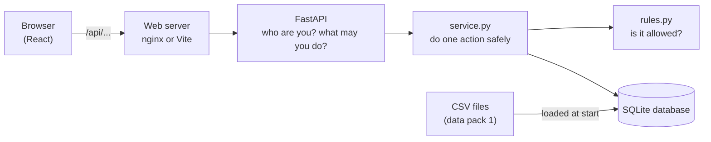

# 👁️ NetraCare: Clinic Booking Website

A website for a (fictional) eye clinic. Patients book appointments, Staff manage the day, Doctors see their schedule.
The server checks every clinic rule, so nobody can make a booking that breaks one.

> All data is synthetic (course data pack 1). There is **no AI** in this project: every decision is plain Python code.

---

## ✨ What you can do

| Role | Can do |
|---|---|
| 🧑 **Patient** | Log in, see doctors, see free times, book, cancel, reschedule, see their own appointments |
| 🧑‍💼 **Staff** | See all appointments (filter by day or doctor), book for anyone, register walk-ins, cancel anything, approve or reject late requests, add holidays, edit doctors' weekly schedules, see a doctor's week |
| 🩺 **Doctor** | See their own schedule for a day (with patient names), mark a visit completed, see their own week |

## 🚀 Run it

**With Docker (easiest)**
```bash
docker compose up --build
```
Open **http://localhost:5171**. API docs: http://localhost:8001/docs.
Stop with `docker compose down` (data is kept) or `docker compose down -v` (data is deleted).

**Without Docker** (needs Python 3.10+ and Node.js 18+)
```bash
cd backend
pip install -r requirements.txt
python -m uvicorn app.main:app --port 8000
```
```bash
cd frontend
npm install
npm run dev
```
Open **http://localhost:5173**. The first start creates `backend/netracare.db` from the CSV files.

**Logging in** (no passwords, so this is classroom-level security only)

| Role | Enter |
|---|---|
| Patient | A mobile number and name from [`patients.csv`](backend/data/patients.csv), for example `9000000001` / `Asha Verma`. A new mobile number creates a new patient. |
| Staff | Any name |
| Doctor | Pick a name from the list |

## 🏗️ How it works



1. The **browser** shows the screens and sends requests to `/api/...`. It never decides anything itself.
2. **FastAPI** (`main.py`) reads the login token and checks the role on every request.
3. **`service.py`** runs one action (book, cancel, ...) in a single database transaction, so two people cannot take the same slot.
4. **`rules.py`** is the only place with clinic rules. If one is broken, the action stops and the server replies with a clear message.
5. **SQLite** stores everything. The CSV files fill it the first time the app starts.

**Example, booking a slot:** you click a time → the browser sends `POST /api/appointments` → FastAPI confirms you are a patient → `rules.py` runs its checks → if all pass, one row is saved; if not, you see a message like *"Dr. Meera Iyer is not at the clinic on Thursdays."*

## 📋 Clinic rules

Checked in this order. Each refusal has a short code and a plain sentence.

| # | Rule | Code |
|---|---|---|
| 1 | Start on a 10-minute mark (new consultation = 20 min, follow-up = 10 min) | `INVALID_START_TIME` |
| 2 | Not in the past | `IN_PAST` |
| 3 | At most 30 days ahead | `BEYOND_30_DAYS` |
| 4 | Not on a Sunday | `CLINIC_CLOSED` |
| 5 | Not on a holiday | `HOLIDAY` |
| 6 | Inside 09:00-13:00 or 14:00-18:00 | `OUTSIDE_SESSION` |
| 7 | Must finish before the session ends | `ENDS_AFTER_SESSION` |
| 8 | Doctor is at the clinic that session | `DOCTOR_OFF` |
| 9 | Doctor is not in surgery | `SURGERY_SESSION` |
| 10 | Doctor covers that speciality | `SPECIALITY_MISMATCH` |
| 11 | Slot is not already taken | `DOUBLE_BOOKED` |
| 12 | A follow-up needs a completed earlier visit, with the same doctor | `NO_PREVIOUS_VISIT`, `FOLLOW_UP_DIFFERENT_DOCTOR` |
| 13 | One active booking per speciality | `ACTIVE_BOOKING_EXISTS` |
| 14 | A patient can cancel or reschedule until 2 hours before. After that: "Please contact Staff" (the request is saved for Staff to approve or reject) | `INSIDE_2_HOURS` |

## 🔌 API

All paths start with `/api` in the browser (the web server removes it before calling FastAPI). Try them at `/docs`.

| Method | Path | Who | What it does |
|---|---|---|---|
| GET | `/health` | public | Is the server up, and what time does the clinic think it is |
| POST | `/login` | public | Log in as `patient`, `staff` or `doctor`; returns a token |
| GET | `/doctors` | public | The 5 doctors and their specialities |
| GET | `/me` | any logged-in user | Who am I |
| GET | `/schedule` | any logged-in user | Doctors' weekly schedule |
| GET | `/holidays` | any logged-in user | Clinic holidays |
| GET | `/slots` | any logged-in user | Free start times for a doctor, date, speciality and visit type |
| GET | `/appointments` | any logged-in user | List appointments (patients and doctors only see their own) |
| POST | `/appointments` | patient, staff | Book |
| POST | `/appointments/{appointment_id}/cancel` | patient, staff | Cancel |
| POST | `/appointments/{appointment_id}/reschedule` | patient, staff | Move to another time (the old one is cancelled only if the new one is accepted) |
| POST | `/appointments/{appointment_id}/complete` | doctor | Mark the doctor's own visit completed |
| GET | `/patients` | staff | List patients |
| POST | `/patients` | staff | Register a walk-in patient |
| GET | `/staff/approvals` | staff | Late cancel/reschedule requests waiting for Staff |
| POST | `/staff/approvals/{approval_id}/approve` | staff | Approve and carry it out |
| POST | `/staff/approvals/{approval_id}/reject` | staff | Reject; the appointment stays |
| POST | `/holidays` | staff | Add a holiday |
| DELETE | `/holidays/{date}` | staff | Remove a holiday |
| PUT | `/schedule` | staff | Set a doctor's status (OPD, SURGERY or OFF) for a day and session |
| GET | `/calendar` | staff, doctor | One doctor's week (a doctor always gets their own) |

Protected calls need the header `Authorization: Bearer <token>`. When a rule is broken, the reply is HTTP 409 like this:
```json
{ "detail": { "code": "DOCTOR_OFF", "message": "Dr. Meera Iyer is not at the clinic on Thursdays.", "to_staff": false } }
```
(Other errors use 401 not logged in, 403 not allowed for your role, 404 not found, 422 bad input.)
A holiday or schedule change that would break an existing booking is refused too (`HOLIDAY_HAS_BOOKINGS`, `SCHEDULE_HAS_BOOKINGS`).

## 🗂️ Data

All in [`backend/data`](backend/data), from the course data pack 1:

| File | Rows | Used for |
|---|---|---|
| `doctors.csv` | 5 | Doctors and their specialities |
| `weekly_schedule.csv` | 60 | OPD / SURGERY / OFF for each doctor, day and session |
| `holidays.csv` | 30 | Days the clinic is closed |
| `patients.csv` | 25 | Patients (login by mobile number and name) |
| `stretch/appointments_seed.csv` | 19 | Sample bookings, loaded only if you ask (see below) and used by the tests |
| `stretch/rule_tests.csv` | 38 | Test cases for the rules |

Appointments start **empty**. Optional settings (environment variables):

| Variable | Meaning |
|---|---|
| `NETRACARE_SEED_APPOINTMENTS` | Set to `1` to also load the 19 sample bookings |
| `CLINIC_NOW` | Freeze the clinic clock, for example `2026-11-02T10:00` (used for demos and tests) |
| `CLINIC_TZ` | Docker only: the clinic's timezone (default `Asia/Kolkata`) |
| `NETRACARE_DB` | Where the SQLite file lives |
| `NETRACARE_DATA_DIR` | Where the CSV files are |
| `BACKEND_PORT` | Dev server only: port of the backend (default `8000`) |

Fixed-clock demo: `NETRACARE_SEED_APPOINTMENTS=1 CLINIC_NOW=2026-11-02T10:00 docker compose up --build`

## 🧪 Tests

```bash
cd backend
pip install -r requirements-dev.txt
python -m pytest -q
```
**92 tests, all passing.** They call the real API on a fixed clock (`2026-11-02T10:00`) using only data pack 1.

| File | Tests | Checks |
|---|---|---|
| `test_rule_cases.py` | 39 | All 38 cases in `rule_tests.csv` |
| `test_handout_checklist.py` | 26 | The assignment's requirements and its checklist |
| `test_stretch_goals.py` | 14 | Reschedule, approvals, holidays, schedule editing, week calendar |
| `test_roles_and_flows.py` | 13 | Logins, role limits, follow-ups, free slots |

The frontend has no automated tests; `npm run build` checks that it compiles.

## 📁 Project layout

```
backend/
  app/
    main.py       the API routes and role checks
    service.py    the actions (book, cancel, reschedule, ...)
    rules.py      every clinic rule
    db.py         database tables and CSV loading
    config.py     settings and the clinic clock
  data/           the CSV files
  tests/          the automated tests
frontend/
  src/App.jsx     all the screens
  src/api.js      talks to the API
docker-compose.yml   runs backend + frontend together
AUDIT.md             check of the project against the assignment
```

## 🛠️ Built with
Python, FastAPI, SQLite (no ORM) · React 18, Vite 5 · pytest · Docker Compose, nginx

## ⚠️ Limitations
- Logins have no passwords. Tokens never expire and there is no logout call (the page just forgets its token).
- A doctor can mark any of their own booked visits completed, even a future one.
- The frontend has no automated tests.
